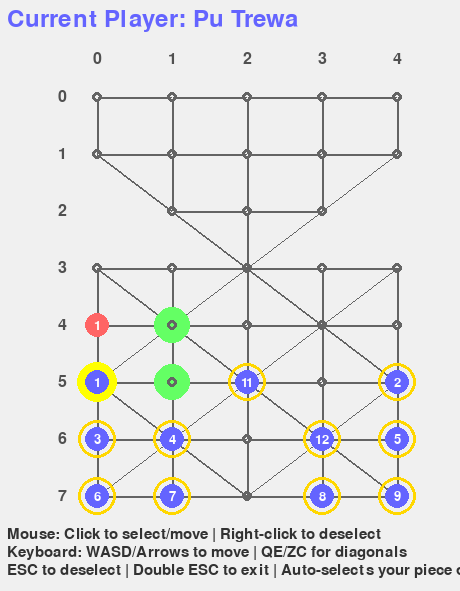
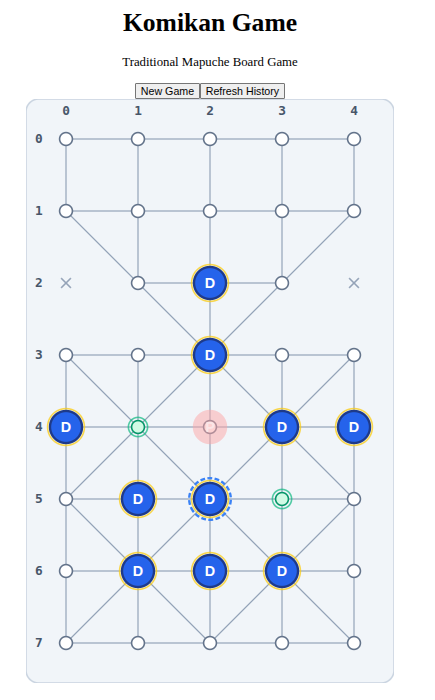

# Komikan Game

A digital implementation of Komikan, a traditional Mapuche board game from southern Chile and Argentina. This project includes both a Pygame desktop version and a modern web interface with REST API.

## Features

- **Pygame Desktop Version**: Traditional desktop game with visual interface
- **REST API**: FastAPI-based backend for game management
- **Web Interface**: React + TypeScript frontend with real-time game state
- **Multiple Concurrent Games**: Support for multiple simultaneous game sessions
- **Move History**: Complete audit trail of all moves with timestamps
- **Win Condition Detection**: Automatic detection of game-ending states

## Screenshots

<!-- Replace placeholders with actual screenshots or GIFs -->

| Desktop (Pygame) | Web (React) |
|---|---|
|  |  |
| *Desktop gameplay — coming soon* | *Web gameplay — coming soon* |

## Game Overview

Komikan is an asymmetric hunt game where:

- **North (Pangui/Puma)**: 1 red token, can capture by jumping
- **South (Pu Trewa/Dogs)**: 12 blue tokens, win by surrounding
- **Board**: 5×8 grid with special disabled nodes and paths
- **Objective**: North captures tokens, South traps the Puma

See [docs/GAME_RULES.md](docs/GAME_RULES.md) for complete rules.

## Getting Started

### Prerequisites

- **Python 3.11 or higher**
- **Node.js 18 or higher** (for web version)
- **pip** (Python package installer)

### Installation

1. **Clone the repository:**

   ```bash
   git clone https://github.com/diegoquintanav/komikan-game.git
   cd komikan-game
   ```

2. **Install Python dependencies:**

   ```bash
   pip install -e .
   ```

3. **For web version, install frontend dependencies:**

   ```bash
   cd frontend
   npm install
   cd ..
   ```

## Play Your First Game

### Option 1: Web Version (Recommended)

The easiest way to play Komikan with a modern browser interface:

1. **Start the backend API:**

   ```bash
   python -m uvicorn komikan.api.main:app --reload
   ```

   The API will be available at <http://localhost:8000>

2. **In a new terminal, start the frontend:**

   ```bash
   cd frontend
   npm run dev
   ```

   The web interface will be available at <http://localhost:5173>

3. **Open your browser and visit:** <http://localhost:5173>

4. **Play the game:**
   - Click "New Game" to start
   - Click on the red token (Pangui/North player) to select it
   - Valid moves will highlight in green
   - Click a green highlighted square to move
   - The game alternates between North (red) and South (blue) players
   - Watch the move history on the right side
   - Game ends when North captures enough tokens or South traps North

### Option 2: Desktop Pygame Version

Play using the traditional desktop interface:

```bash
python -m komikan
```

**Controls:**

- **Mouse**: Click to select and move tokens
- **Keyboard**: WASD or arrow keys to move selected token
- **ESC**: Deselect or exit (double-tap within 2 seconds)

### Option 3: Using Docker

Run both frontend and backend with a single command:

```bash
docker-compose up
```

Then visit:

- Frontend: <http://localhost:5173>
- Backend API: <http://localhost:8000>
- API Docs: <http://localhost:8000/docs>

## API Usage

You can also interact with the game programmatically using the REST API.

### Example: Play a game via API

```bash
# Create a new game
curl -X POST http://localhost:8000/api/games

# Sample response will include a game_id, use it in subsequent requests
# Example: game_id = "abc123..."

# Get valid moves for a token at position (2, 0)
curl "http://localhost:8000/api/games/abc123/valid-moves?from_x=2&from_y=0"

# Make a move
curl -X POST http://localhost:8000/api/games/abc123/moves \
  -H "Content-Type: application/json" \
  -d '{"from_x": 2, "from_y": 0, "to_x": 2, "to_y": 1}'

# Get move history
curl http://localhost:8000/api/games/abc123/moves
```

### API Endpoints

- `POST /api/games` - Create a new game
- `GET /api/games/{game_id}` - Get current game state
- `POST /api/games/{game_id}/moves` - Submit a move
- `GET /api/games/{game_id}/moves` - Get move history
- `GET /api/games/{game_id}/valid-moves` - Get valid moves for a token
- `DELETE /api/games/{game_id}` - Delete/forfeit a game

**Interactive API Documentation:** <http://localhost:8000/docs>

## Testing

### Prerequisites for Testing

Install development dependencies:

```bash
pip install -e ".[dev]"
```

Or if using the dev dependency group:

```bash
# The dev dependencies are already defined in pyproject.toml
# They will be installed with the editable install above
```

### Running All Tests

Run the complete test suite (82 tests):

```bash
pytest tests/ -v
```

**Expected output:**

```
=================== 82 passed, 1 skipped, 1 xfailed in 0.5s ===================
```

### Testing the Backend/API

#### 1. Test Core Game Logic (Board, Players, Movement)

```bash
pytest tests/test_board.py tests/test_player.py tests/test_integration.py -v
```

This tests:

- Board initialization and node management
- Movement validation and path restrictions
- Capture mechanics
- Player state management
- Win conditions

#### 2. Test FastAPI Endpoints

```bash
pytest tests/test_api.py -v
```

This tests:

- Game creation and retrieval
- Move submission and validation
- Move history tracking
- Concurrent game sessions
- Error handling

**Sample output:**

```
tests/test_api.py::test_create_game PASSED
tests/test_api.py::test_make_valid_move PASSED
tests/test_api.py::test_get_move_history PASSED
tests/test_api.py::test_concurrent_games PASSED
```

#### 3. Run Specific Tests

```bash
# Test only capture mechanics
pytest tests/test_board.py::TestBoardCapture -v

# Test only API game creation
pytest tests/test_api.py::test_create_game -v

# Test with detailed output
pytest tests/test_api.py -v -s
```

### Testing the Frontend (React)

The frontend uses TypeScript for type checking and ESLint for code quality.

#### 1. Type Checking

```bash
cd frontend
npm run build
```

This runs TypeScript compiler (`tsc -b`) to check for type errors.

**Successful output:**

```
vite v8.0.0-beta.14 building client environment for production...
transforming...
✓ built in 410ms
```

#### 2. Linting

```bash
cd frontend
npm run lint
```

This checks code quality and style using ESLint.

#### 3. Development Build Test

```bash
cd frontend
npm run dev
```

Then visit <http://localhost:5173> to verify the frontend works correctly.

#### 4. Production Build Test

```bash
cd frontend
npm run build
npm run preview
```

This builds the production bundle and serves it locally for testing.

### Running Tests with Coverage

```bash
# Install coverage tool if not already installed
pip install pytest-cov

# Run tests with coverage report
pytest tests/ --cov=komikan --cov-report=html

# Open htmlcov/index.html in your browser to see detailed coverage
```

## Development

See [DEVELOPMENT.md](DEVELOPMENT.md) for detailed development instructions.

### Project Structure

```
komikan-game/
├── src/komikan/          # Python source code
│   ├── board.py          # Game board logic
│   ├── player.py         # Player management
│   ├── run.py            # Pygame interface
│   └── api/              # FastAPI REST API
│       ├── main.py       # API endpoints
│       ├── models.py     # Pydantic models
│       └── game_manager.py  # Game state management
├── frontend/             # React + TypeScript frontend
│   ├── src/
│   │   ├── components/   # React components
│   │   ├── types/        # TypeScript types
│   │   └── api.ts        # API client
│   └── dist/             # Production build
├── tests/                # Test suite (82 tests)
│   ├── test_board.py     # Board logic tests
│   ├── test_player.py    # Player tests
│   ├── test_integration.py  # Integration tests
│   └── test_api.py       # API tests
└── docs/                 # Documentation
    └── GAME_RULES.md     # Complete game rules
```

## Technology Stack

- **Backend**: Python 3.11+, FastAPI, Pydantic, Pygame
- **Frontend**: React 18, TypeScript, Tailwind CSS, Vite
- **Testing**: pytest, httpx, pytest-asyncio
- **Deployment**: Docker, docker-compose

## Win Conditions

- **North (Pangui) wins**: Captures enough South tokens (≤4 remaining)
- **South (Pu Trewa) wins**: Traps North with no valid moves
- **Stalemate**: South has no valid moves on their turn

## Troubleshooting

### Common Issues

**"No module named 'komikan'"**

- Make sure you installed the package: `pip install -e .`

**"Command not found: npm"**

- Install Node.js from <https://nodejs.org/>

**"Port 8000 already in use"**

- Stop any other application using port 8000, or run the API on a different port:

  ```bash
  python -m uvicorn komikan.api.main:app --port 8001
  ```

**Frontend can't connect to API**

- Make sure the backend is running on port 8000
- Check the `.env` file in the frontend directory

## License

This project is an educational implementation of a traditional Mapuche game.
See [LICENSE](LICENSE) for details.

## Credits

Based on the traditional Mapuche board game Komikan. Learn more at [Komikan on Adrián Cheuque Pan's website](https://adriancheuquepan.cl/komikan/).
